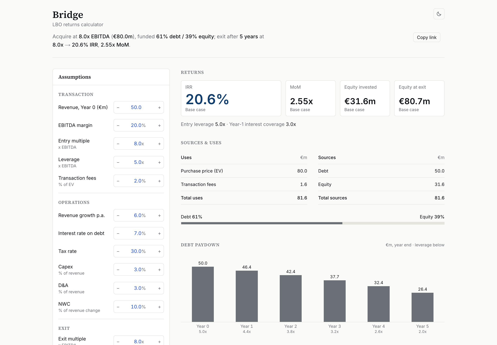

# Bridge · LBO returns calculator

**Live:** https://bridge-lbo.vercel.app

Bridge models a simple leveraged buyout in the browser. Change the deal assumptions and it instantly shows the returns (IRR and MoM), the debt paydown year by year, a value creation bridge from equity invested to equity at exit, and an IRR sensitivity grid of entry against exit multiple. It opens on a complete base case, so there is something sensible to read before touching anything.



## Methodology in brief

The full methodology, with every formula, is on its own page: [bridge-lbo.vercel.app/methodology](https://bridge-lbo.vercel.app/methodology). In short:

1. **Entry.** EV = EBITDA × entry multiple. Debt = EBITDA × leverage. Fees are a percentage of EV and are funded with equity, so equity invested = EV + fees − debt.
2. **Operations.** Revenue grows at a constant rate; EBITDA, D&A and capex are percentages of revenue, and working capital is a percentage of the change in revenue. Free cash flow = net income + D&A − capex − ΔNWC.
3. **Debt and cash.** Interest is charged on the opening debt balance (no circularity). All free cash flow repays debt (a 100% cash sweep); once the debt is gone, cash builds up. A negative free cash flow is funded with more debt and flagged.
4. **Exit and returns.** EV at exit = final-year EBITDA × exit multiple. Equity at exit = EV − debt + cash. With only two equity cash flows, IRR = MoM^(1/N) − 1.
5. **Value creation bridge.** The gain splits into EBITDA growth, multiple expansion, debt paydown, cash build-up and fees, and the parts add up exactly to equity at exit − equity invested.
6. **Sensitivity.** Each cell of the 5 × 5 grid is a full re-run of the model with only the entry and exit multiple changed.

Simplifying assumptions, stated openly: one debt tranche, interest on the opening balance, 100% cash sweep, no minimum cash, no amortisation schedule, exit at the end of the final year, no dividends, fees fully equity-funded, no management equity. Inputs are blue and calculated values are black, the banking Excel convention.

*Illustrative model for educational purposes. Not investment advice.*

## Verified against the Excel model

I designed the model by hand in Excel first. The app's calculation engine (`lib/lbo/`) is plain TypeScript with no React, and it is tested against that spreadsheet:

- **Golden values** (`lib/lbo/__tests__/golden.test.ts`): the base case must reproduce the Excel figures (EV, fees, equity invested, revenue, EBITDA, interest, free cash flow and debt for every year, exit EV and equity, MoM 2.55x, IRR 20.6%) and all 25 cells of the Excel sensitivity grid, within ±0.05 for €m and multiples and ±0.1 percentage points for IRR.
- **Invariants** (`lib/lbo/__tests__/scenarios.test.ts`): for 1,000 random valid inputs the bridge reconciles exactly to the equity gain and no NaN, Infinity or undefined appears anywhere, including the grid. Edge cases are covered too: debt fully repaid (cash builds, debt never negative), negative free cash flow (debt rises, warning raised), equity at exit ≤ 0 (IRR shown as n.m.), and leverage at or above the entry multiple (rejected).
- **Display** (`lib/__tests__/`): formatting, the projection table footing, chart figures and the contrast of every sensitivity-grid colour in both themes.
- **In the browser** (`scripts/check-browser.mjs`): the production build and the dev server in Chrome, light and dark, desktop and phone width, with no console errors or warnings and the main interactions working.

The link preview image is rendered from the engine at build time, so even the 20.6% in it is calculated, not typed.

## How it was built

The app was built in phases from a written specification, [docs/PROJECT_BRIEF.md](docs/PROJECT_BRIEF.md): engine and golden-value tests first, then layout and inputs, tables, charts, polish and shipping, with a review against the brief after each phase.

## Stack

- [Next.js](https://nextjs.org) (App Router) as a fully static export: no server, no database, no cookies, no analytics
- TypeScript (strict) and Tailwind CSS, with design tokens as CSS variables for light and dark mode
- Hand-built SVG charts, no chart library
- [Vitest](https://vitest.dev) for the model and display tests, [Playwright](https://playwright.dev) for the browser check
- Inter and Source Serif 4 (SIL Open Font License; the copies in `assets/fonts` are used only for the link preview image)
- Hosted on [Vercel](https://vercel.com)

## Run it locally

Requires Node.js 22 or later (`nvm use` picks it up from `.nvmrc`).

```bash
npm install
npm run dev            # http://localhost:3000
```

Checks:

```bash
npm test               # model and display tests
npm run typecheck
npm run lint
npm run build          # static export to out/
npm run check:browser  # needs Google Chrome installed (or: npx playwright install chromium)
```

## About

Built by Seyon Nagendram · [LinkedIn](https://www.linkedin.com/in/seyon-nagendram)

Built with AI-assisted development (Claude Code). The model was designed by hand in Excel first, and the app is verified against it by automated tests.
